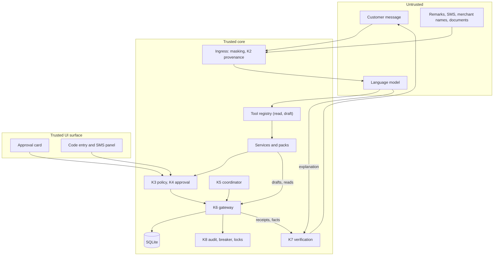

# Architecture

YUKI - 安全可控的跨场景 AI 银行智能体 (the repository and code are named WealthGuard) is one repository, one backend process and one SQLite database file per working copy. This document describes the parts, how a request flows through them, and the rules that keep the language model away from money movement. Commands to run the system are in the [README](../README.md); test layers are in [testing.md](testing.md).

## 1. Parts

| Part | Where | Notes |
| --- | --- | --- |
| Backend | `backend/wg/` | Python 3.12, FastAPI, Pydantic v2, SQLite (WAL). One process |
| Frontend | `frontend/` | React and TypeScript, built with Vite, served by the backend at `/` |
| Bank simulator | `backend/wg/k6/bank.py` | Keeps its own request records and posts balanced ledger entries; shares the database with the gateway |
| Step-up | `backend/wg/core/k4_approval.py` | `VerificationProvider` with `deliver` and `withdraw`; `SimulatedSms` keeps an open code in `sms_outbox` until the challenge closes |
| Model adapter | `backend/wg/agent/llm.py` | OpenAI-compatible chat completions with tool calls (DeepSeek), or a stub that replays a script |
| Feishu adapter | `backend/wg/im/feishu.py` | Separate process; long-connection client; talks to the backend over HTTP |
| Public data | `backend/wg/sources/`, `data/public/` | Offline parser for two public fund reports; no network, no database access |

Package layout under `backend/wg/`:

| Package | Contents |
| --- | --- |
| `contracts/` | Shared types, enums, error codes, DTOs, the route table, tool schemas, engine protocols |
| `k6/` | Schema and migrations, the only read-write connection, write repositories, gateway, bank simulator, fault injection, fixture loader |
| `core/` | K1 session, K2 context filter, K3 policy, K4 approval, K5 coordinator, K7 verification, K8 audit; `mandate_rules.py` (pure direct-debit rules) and `k5_mandates.py` (sweep and probes) |
| `packs/` | Action packs: transfer (also bill payment), bills, funds, direct debits (payment of a merchant request, decline, agreement changes, new agreement) |
| `services/` | In-process facade used by routes and tool handlers; `mandates.py` for agreements, requests and their drafts |
| `api/` | FastAPI application and routes |
| `agent/` | Model adapter, tool registry, agent loop, prompts, chat turn |
| `numeric/` | Pure functions: cash snapshot, exposure, candidate search, fees, stress, purchase revision |
| `textcheck/` | Pure functions: amount parser, secret masking, claim checking |
| `im/` | Channel binding and message service, Feishu adapter |
| `sources/` | Offline extraction and reconciliation of public reports |

## 2. Trust zones

- Untrusted: the model, its text, and every external string (payment remarks, SMS text, merchant names, document text, IM messages).
- Trusted core: K1–K8 and the database.
- Trusted UI surface: the approval card, the code field and the simulated SMS panel. They are rendered or served by the backend and sit outside the chat.

The model reaches the core only through the tool registry, and the core returns only facts to the model.

## 3. One write path

- `wg/k6` owns the only read-write connection factory and every write repository. Other modules call narrow K6 methods. Reads use separate read-only connections.
- Every write runs inside `unit_of_work`, which issues `BEGIN IMMEDIATE` and commits when the block ends or rolls back when it raises. Units never nest. No network call, model call or PDF parsing happens inside a unit.
- Domain events and audit rows are written in the same unit as the change they describe, so a crash leaves either both or neither.
- `scripts/scan_writes.py` fails when a SQL write statement appears in a string outside `wg/k6`; `scripts/check.sh` runs it.
- A failure that rolls back a unit is recorded afterwards in its own unit (`failure_records`), where K8 counts it for the breaker.

## 4. Request flow

### 4.1 Chat turn

1. The route `POST /v1/chat/messages` takes the customer from the session cookie. The message is masked (PINs, CVVs, card numbers and codes next to keywords become `[已隐藏]`) and stored in masked form before any model call.
2. The model receives the system prompt, up to 20 earlier masked messages of the session, and the tool schemas allowed for the channel.
3. Each tool call goes through `ToolRegistry.call`, which checks in order: tool exists, channel, capability (`read` or `draft`), argument schema (unknown fields are rejected and audited), read scope of the declared intent, then the handler. At most 8 tool calls run per turn; later calls in the same reply are refused and one last model call without tools produces the text.
4. Draft handlers run K2. Each amount and payee must come with a quote of the customer's words. The quote is parsed independently and must lie outside the remark; the provenance label is derived from where the quote lies. Untrusted provenance is refused, a second candidate amount is a missing-slot clarification, and a payee name that matches several saved payees is ambiguous.
5. A draft is an action in `DRAFT` with canonical parameters, a request hash, a tier and a feasibility verdict. It grants nothing.
6. The reply has a fact block rendered by the server from typed facts and the model's explanation. K7 checks every amount, percent, count and status word in the explanation against facts of the matching meaning; any mismatch replaces the explanation with a template and writes an `explanation_replaced` audit row.

### 4.2 Approval and execution

1. The customer opens the card on the trusted surface. The server renders it from the stored action and shows the tier, exact terms, before and after values, and source labels for anything that came from untrusted text.
2. Confirm sends the terms hash the card displayed. The server recomputes the terms from the action row; any mismatch is refused. A confirmed card creates an approval.
3. A red action then needs a challenge. A challenge is issued by a customer action only, bound to the action, revision and scope hash, valid for five simulated minutes and three attempts. The code appears in the SMS panel; the model never sees it.
4. A verified challenge is a grant. The gateway consumes it in the submitting transaction.
5. The gateway submits in one unit of work: load the action at its revision, check status and locks, look up the idempotency key, check the grant, run the pack's prechecks, reserve funds, apply the effect through the bank simulator, write the operation, events, audit and domain event, and commit. Same-bank transfers settle inside that unit; other settlements are due at the next 09:00 China Standard Time.
6. A terminal outcome creates one immutable receipt. K7 later checks the outcome of the action from the receipt and ledger rather than from the model's words.

### 4.3 Plans and time

A plan is a dependency graph of actions: for the rebalance scenario, a redemption, a bill payment, a purchase that depends on the redemption, and a checkpoint five days later. The plan card is one yellow approval that binds the listed actions, limits and bounds. Each red action still gets its own code when it becomes due.

- K5 is the only workflow owner. A tick runs on events, never on a background loop: clock advance, process start, a customer action, a changed commitment, a gateway receipt. Each plan is processed in its own unit; transitions are idempotent, so two concurrent ticks equal one.
- The simulated clock is stored in the database and moves only through `POST /sim/clock/advance` or `POST /sim/reset`. Advancing walks the due instants in order (settlements, `not_before` times, plan expiry), applying settlements and ticking plans at each.
- A new bill that changes headroom can revise the purchase amount. The decision is a pure function against the original baseline: `unchanged`, `revise` within the approved bounds (a new revision that needs a fresh code for the exact amount), or `pause` with reasons. A change outside the bounds needs a new approval.
- The checkpoint evaluates sector exposure on positions settled at that instant and records `passed`, `failed` or `checkpoint_missed`. A late settlement never rewrites an earlier checkpoint.
- A flat mode, used only for the comparison experiment, disables plan composition, plan approvals and revisions for a session while leaving the model, tools, gateway and data unchanged.

### 4.4 Restart recovery

On start, before the first request, the coordinator: reconciles every submitted or unknown operation against the bank simulator's record; replays unprocessed domain events; applies settlements due at the current simulated time; resubmits ready actions with the same key if the grant is still valid, otherwise returns them to step-up. An operation whose bank record is missing is an integrity violation and locks the customer. `scripts/supervise.sh` restarts the process after a crash.

### 4.5 IM channel

A customer creates a six-digit pairing code in the web app; sending `绑定 <code>` in Feishu binds the sender. Inbound messages go through the same chat turn with the channel set to `im`, which exposes read and draft tools. Replies contain facts and a link to the trusted web card. Duplicate deliveries are dropped by message ID, and approvals and codes are refused in IM. The adapter authenticates to the backend with `WG_CHANNEL_SECRET`.

### 4.6 Merchant debit requests

A merchant debit request reaches the system only through `receive_debit_request` in `wg/k6/debit_requests.py`; in the prototype the simulator route `POST /sim/debit-requests` (demo mode) calls it. The system never pulls money on a request by itself.

1. One unit of work checks the format (positive integer fen, currency `CNY`; a bad request is refused with `FORMAT_ERROR` and audited, not stored). A repeated `(merchant_id, merchant_request_id)` returns the stored request.
2. The decision follows an allow-list, in this order, and the first failing check decides: the merchant is a verified registry merchant and the reference names its agreement (else `AUTO_DECLINED NO_MANDATE`); the agreement is `ACTIVE` (else `AUTO_DECLINED` with the agreement's status); the agreement has not expired (decided by comparing the clock with the end date, not by the stored status); the amount is within the cap (else `OUT_OF_MANDATE CAP`); the month has no accepted request and fewer than three stored requests (else `OUT_OF_MANDATE PERIOD_USED`). Otherwise the request is `AWAITING_CLIENT`.
3. Every stored request gets a month key (China Standard Time) and a reply deadline of 72 simulated hours. The merchant's text is stored unchanged, labelled untrusted, and never read as an instruction.
4. Nothing else happens: no action, no hold, no notification. The customer pays or declines from the request list. `DEBIT_PAY` is a payment action with its own pack: it is counted in the daily sum and tiered like a transfer, re-checks the request, the agreement version, the cap and the funds at approval and at submission, and settles in the submitting unit (customer account debited, clearing account credited, request set to `PAID` with the operation). `DEBIT_DECLINE` sets the request to `DECLINED` without an operation. Both carry the agreement version, so a card drawn before a change is refused (`MANDATE_CHANGED`, `REQUEST_NOT_PAYABLE`) and shows as expired.
5. Agreement changes (`MANDATE_CANCEL`, `MANDATE_SUSPEND`, `MANDATE_RESUME`, `MANDATE_CAP_LOWER`, `MANDATE_CAP_RAISE`, and `MANDATE_CREATE` for a new agreement) are money-less operations through the gateway: no reservation and no ledger entry, one settled operation with a receipt, one append-only `mandate_events` row per changed field. Cancelling, suspending, lowering the cap and declining are risk-reducing and pass a lock; paying, resuming, raising the cap and creating do not. Resuming, raising the cap and creating need a code.

Protection of coming periods. Subscription periods are derived, not stored: from the agreements, the requests and the clock, `mandate_rules.protected_periods` lists the periods that must stay funded (a waiting request, a declined request until its reply deadline, the current and next month while the agreement is active or suspended and the date is within 30 days, and the nearest date after a cancellation). `k6/cash_inputs.py` passes them to the unchanged cash engine as extra commitment inputs with ids `cmt_sub_<agreement>_<YYYYMM>`. They are not rows of `commitments`, do not move `commitments_version` and do not appear in the bill list; the cash snapshot reports them in `details.subscriptions`. Cancelling, suspending or declining therefore never frees money at once: the reserve falls at the reply deadline, after the period's date (cancel) or at month end. Plan continuation does not react to them (T110 is not built); the gateway's headroom checks do see them.

Sweep. `k5_mandates.sweep` runs at each clock step, at start-up and after every confirm and verify of a customer, each item in its own unit: unanswered requests past their deadline become `EXPIRED`; agreements past their end date become `EXPIRED` and their waiting requests `AUTO_DECLINED`; payment, decline and change actions that an agreement change or a closed request made stale are cancelled; effect probes are sent for settled changes. The deadlines and end dates are due instants of the clock walk, so one long clock advance visits them in order.

Probes. After a settled cancel, suspend or cap lowering the sweep sends a request marked `probe` (the agreement's expected amount, or the new cap plus one fen) through the same `receive_debit_request`. A refusal appends a `verified` effect event; an accepted probe appends `failed` and locks the customer as an integrity incident; a simulated timeout appends `pending` and the next sweep retries, unless a later change of the same agreement has overtaken the operation. Probe rows are excluded from every list, count, total, protection and payment path. The receipt stays settled and unchanged; the effect check is read from the newest event.

Integrity. `check_mandate_invariant` compares the newest `status` and `cap_fen` events of an agreement with the agreement row. A difference is an `INTEGRITY_VIOLATION` (`mandate_event_mismatch`) that locks the customer; reads and reconciliation keep working.

Chat. Five tools under the intent `subscriptions.manage` read agreements, requests and spend, and draft a change or a pay or decline decision. A draft needs a quote of the customer's words naming the agreement and the decision; a quote taken from a request's text is `UNTRUSTED_SOURCE`. K7 holds facts for agreement status, cap, expected amount, monthly total, request status, reason and deadline, and the effect check; an explanation may say the debit authorisation is closed only with a verified effect check, and "订阅已取消" (subscription cancelled) is always replaced, because the service contract is not touched.

## 5. Policy and authority

| Tier | Requirement | Examples |
| --- | --- | --- |
| GREEN | Signed-in session | Reads, drafts, cancel of an unsubmitted action |
| YELLOW | Trusted confirm | Transfer or bill payment within a ¥1,000 daily total, reserve increase, plan approval |
| RED | Trusted confirm and code | Daily total above ¥1,000, reserve decrease, fund redemption and purchase |
| FORBIDDEN | Refused | Single transfer above ¥50,000, daily total above ¥100,000, writes under a lock |

Direct-debit actions: `DEBIT_PAY` is tiered from the daily sum like a transfer; decline, cancel, suspend and cap lowering are YELLOW; resume, cap raise and a new agreement are RED. A cap above ¥50,000 is refused (`SINGLE_LIMIT_EXCEEDED`).

- The daily sum counts transfers, bill payments and direct-debit payments submitted that day (China Standard Time) with status submitted, settled or unknown. The gateway recomputes the tier inside the submitting transaction and returns the action to step-up if it rose.
- Read scopes map each declared intent to the data sources a tool may read. The intent comes from the model, so the registry is a data-minimization control and a metric; the authorization boundary is customer ownership, enforced from the session. A foreign or missing object returns the same `404` body.
- K8 counts unexpected failures per plan. Three in a row lock the plan; integrity violations lock the plan or customer. Under a lock, reads, reconciliation, audit and settlement of accepted operations continue; new writes are refused except risk-reducing ones. Only an operator can unlock, with a reason, and unlocking creates no approval.
- Roles are `customer`, `operator` and `demo`, each with its own HttpOnly, SameSite=Strict cookie. State-changing human routes require the `X-CSRF-Token` of the role. The Feishu route requires `X-Channel-Secret`.

## 6. Data

- Money is integer fen in storage, Python and JSON, with field names ending in `_fen`. Shares, NAV, weights and percentages are `Decimal`, stored as text and serialized as strings. Times are ISO 8601 text in Asia/Shanghai.
- Main tables: customers, sessions, accounts, payees, plans, actions (with revisions), approvals, challenges, operations and their events, reservations, ledger entries, receipts, bank requests, domain events, audit log, locks, breaker state, failure records, the simulated clock, faults, chat messages, cards, the S2 and S3 tables (transactions, commitments, cash snapshots, products, positions, lots, holdings snapshots, calc results) and the direct-debit tables (`merchants`, `mandates`, `mandate_events`, `debit_requests`, `effect_verification_events`). The schema is in `backend/wg/k6/schema/` (seven migrations).
- Migration 7 rebuilds `actions` to widen the check on the action kinds. SQLite cannot widen a check in place, and dropping a parent table with foreign keys on fails, so a migration whose first line is `-- foreign_keys: off` runs in its own mode: foreign keys off outside any transaction, `BEGIN IMMEDIATE`, the statements, `PRAGMA foreign_key_check` (any row aborts and rolls back), the schema version row, `COMMIT`, then foreign keys on again and a check that they read 1. Only migration 7 uses it. The migration test builds a populated schema-6 database and checks that rows, foreign keys and indexes survive and that a code issued before the migration still verifies.
- Ledger entries for every operation sum to zero; an account's balance equals the sum of its entries; a bill's unpaid amount equals its amount minus its settled payments. A violation is an integrity failure.
- Cash snapshots and calc results are immutable and addressable by ID. Every number in a reply or on a card cites one, or a receipt.

### Cash and fund engines

Pure functions in `wg/numeric/`, with types in `wg/contracts/engines.py`.

- Cash: `protected = E + L + B + M`, `headroom = max(0, C − protected − U)`, `shortfall = max(0, protected + U − C)`, where C is posted money on covered accounts, E the reserve target, L the remaining everyday allowance, B unpaid confirmed bills in the next 30 days, M a margin and U outgoing holds not tied to a bill. Future salary and unsettled proceeds never count.
- Exposure: sector share is the value-weighted sum of holdings weights, reported as a lower and an upper bound. A target met only between the bounds is `unverified`.
- Candidates: 60 full-reinvestment swaps (12 directed pairs at five amounts) plus no trade, sell only and buy only, each checked against the target, fee cap, turnover cap, minimum purchase, share rounding and projected headroom.
- Fees: gross is shares × NAV, fee is gross × rate, both rounded half-up to the fen, using FIFO lots. An unknown fee is never treated as zero.
- Public data: two fund reports (as of 2026-06-30) are extracted offline, reconciled to the fen against report totals, and stored as non-executable diagnostics. They never back an executable target or order.

## 7. Model boundary

- The model gets read and draft tools only (32 tools). Approve, verify, submit, settle, unlock and the simulator controls are not tools and are refused to any caller that is not a human session with the right role.
- The model never receives account numbers, codes, hashes, session tokens or raw imports. Tool results are filtered of those keys and every string is masked.
- Every model call appends a metadata record to `var/llm_calls.jsonl`: requested and returned model, thinking mode, prompt and tool-schema versions, build ID, latency, token usage and estimated cost. No message text is stored. A spend guard stops new calls when the recorded total reaches `WG_LLM_SPEND_CAP_CNY`.
- The adapter ignores proxy variables in the environment and uses `WG_OUTBOUND_PROXY` only when set.
- Tool schemas are JSON Schema. No MCP server ships; isolation comes from server-side checks, not from the transport.

## 8. Interfaces

- HTTP routes and their request and response models are listed in `backend/wg/contracts/api.py`. Groups: session, reads, drafts, trusted (cards, challenges, SMS, pairing), chat, operator, simulator (demo mode only), and the Feishu channel route.
- The API returns JSON with money in fen and decimals as strings. Status codes: `200` read or repeat, `201` created, `202` accepted but still submitted or unknown, `401` no session, `403` CSRF or role, `404` not found or not owned, `409` state conflict, `422` validation, `423` locked, `503` transient.
- Responses carry `Content-Security-Policy: default-src 'self'; frame-ancestors 'none'`, `X-Frame-Options: DENY`, `Referrer-Policy: no-referrer`, `X-Content-Type-Options: nosniff` and, for API routes, `Cache-Control: no-store`. FastAPI documentation is served only when `WG_DEMO_MODE=1`.
